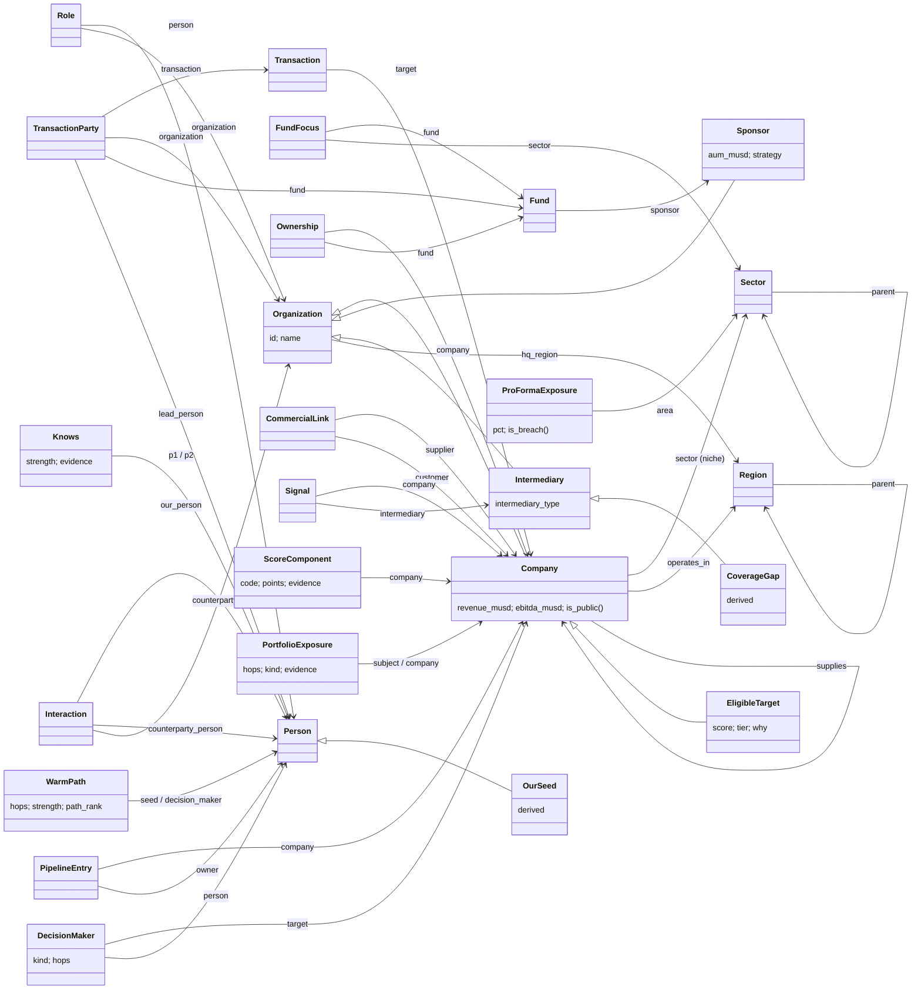

# ONTOLOGY.md - Northwind deal graph

Owner: R08 Ontology Engineer. Code: `pe_deal_graph/model/core.py`. Check: `make ontology-check`.
Readers: R09 (rules.py), R10 (graphs.py), R11 (queries.py, tests), R13 (export), R15 and R16 (explorer and script), R19b.
All data is synthetic and fictional, as of AS_OF = 2026-10-01. Example names are the final R05 names (data/golden/stories.md), not the QUESTIONS.md placeholders. Hero arc (QUESTIONS.md v2): Q-SCORE, Q-PATH, Q-FLOW, Q-CONFLICT, Finale.

## 1. Overview

One model, `Model("pe_deal_graph")`, shared by every layer:

```python
from pe_deal_graph.model import model, Company, Person, Knows   # or get_model(); importing loads core only
import pe_deal_graph.model.rules    # R09: adds the rules for the derived names it owns
import pe_deal_graph.model.graphs   # R10: adds graphs and materializes algorithm outputs
```

- **Core layer (R08).** 17 source tables map to 17 source concepts (including the `Organization` supertype) and two direct relationships (`Company.operates_in`, `Company.supplies`). Names are business names, not column names.
- **Derived layer contract (R08 declares, R09 and R10 populate).** Every derived concept, property and relationship that the questions need is **declared in core.py** with its exact name, reading and types. rules.py and graphs.py import only core.py and add `model.define(...)` rules for the names they own. Neither imports the other, so a graph output (seed distance) can feed a rule (warm-path points) and a rule (Knows) can feed a graph without an import cycle. R11 can write queries against these names before R09 and R10 finish.
- **Do not redeclare a contract name.** The model is append-only. A second `model.Property(...)` under the same name creates a parallel relation that nobody else reads. Populate the declared object, for example `model.define(Company.score(...))`. If a contract name or type must change, ask R08 (or a Fixer with core.py rights) to change core.py and this file together. `make ontology-check` fails on any drift.

## 2. Concept glossary

Source concepts are bound to Snowflake tables in core.py. Derived concepts are declared in core.py and populated by the owner shown.

| Concept | Kind | Business meaning | Identity |
|---|---|---|---|
| `Organization` | source (supertype) | Any firm in the market map: a company, a PE sponsor or an intermediary. Carries the name and HQ region. | `id` (company, sponsor or intermediary id; one shared id space) |
| `Company` | source (subtype of Organization) | An operating business: a target, a portfolio company, a customer or a supplier. | inherited `id` |
| `Sponsor` | source (subtype of Organization) | A private-equity firm, including Northwind itself. | inherited `id` |
| `Intermediary` | source (subtype of Organization) | A sell-side bank, M&A boutique or business broker that brings deals to market. | inherited `id` |
| `Sector` | source | A node in the industry tree: sector > subsector > niche. Companies sit on a niche. | `id` |
| `Region` | source | A node in the geography tree: country > census region > state or province. | `id` |
| `Person` | source | An executive, director, banker or investment professional. | `id` |
| `Fund` | source | A sponsor's investment vehicle, with vintage, size, EBITDA band and concentration guideline. | `id` |
| `FundFocus` | source | One node of a fund's investment thesis: a sector node marked include (with a margin benchmark) or exclude. | `fund_id`, `sector_id` |
| `Role` | source | A dated position a person holds at an organization (CEO, CFO, COO, President, Board, Operating Partner, Deal Team, Banker). | `id` |
| `Ownership` | source | A fund's dated stake in a company (majority or minority, equity invested). | `id` |
| `Transaction` | source | A closed deal on a target company, typed by deal role, seller type and structure. | `id` |
| `TransactionParty` | source | One participant's side in a deal: buyer, seller, owner, advisor, lender or co-investor, with the lead person. | `id` |
| `CommercialLink` | source | A current supplier-to-customer relationship between two companies, with an annual spend band. | `id` |
| `Interaction` | source | A Northwind CRM touchpoint with a person or a firm: date, channel, sentiment. | `id` |
| `PipelineEntry` | source | A company tracked in Northwind's CRM pipeline, with stage and estimated equity check. | `company_id` |
| `Signal` | source | A dated event about a company: banker engaged, debt maturity, add-on announced, press release and similar. | `id` |
| `OurSponsor` | derived (R09) | Northwind Equity Partners, "us". | subtype of Sponsor |
| `OurFund` | derived (R09) | Any Northwind fund (Fund II, III, IV). | subtype of Fund |
| `BuyingFund` | derived (R09) | Fund IV, the fund doing the buying: the Northwind fund with the latest vintage. | subtype of OurFund |
| `OurSeed` | derived (R09) | A Northwind person who can make an introduction: a current Deal Team member or Operating Partner. | subtype of Person |
| `NorthwindHolding` | derived (R09) | A company a Northwind fund owns today (sold companies do not count). | subtype of Ownership |
| `ThesisArea` | derived (R09) | A Fund IV include node: Healthcare Services, Tech-Enabled Business Services, TIC, Specialty Distribution. | subtype of Sector |
| `EligibleTarget` | derived (R09) | A company Fund IV could buy: in thesis, EBITDA in band, US, private, not already ours. Only these are scored. | subtype of Company |
| `ScoreComponent` | derived (R09) | One awarded scoring point bucket for a company, with its evidence in plain words. | `company`, `code` |
| `KnowsEvidence` | derived (R09) | One reason two people know each other: overlapping tenure, a shared deal, or positive CRM contact. | `p1`, `p2`, `kind`, `key` |
| `Knows` | derived (R09) | Two people who know each other, with a tie strength from 0 to 1 and the best evidence. | `p1`, `p2` |
| `DecisionMaker` | derived (R09) | A person who decides on a sale of a target: its CEO, or the owning sponsor's board designee. | `target`, `person` |
| `WarmPath` | derived (R10) | A shortest introduction route from a Northwind seed to a decision-maker, with its strength. | `target`, `decision_maker`, `route` |
| `WarmPathHop` | derived (R10) | One step of a warm path, with the tie evidence for that step. | `path`, `step` |
| `DealFlowTransaction` | derived (R09) | A deal from the last 5 years whose target is in the Fund IV thesis: the deal-flow network's raw material. | subtype of Transaction |
| `CoverageGap` | derived (R09) | An intermediary that bridges a lot of thesis deal flow but that we barely cover. | subtype of Intermediary |
| `ConflictSubject` | derived (R09) | A company we are about to bid on (pipeline stage "IOI prep"): the subject of the conflict check. | subtype of Company |
| `PortfolioExposure` | derived (R09) | A current Northwind holding within two commercial links of a bid subject, classified as conflict or informational. | `subject`, `company` |
| `AreaExposure` | derived (R09) | Fund IV's current equity in one thesis area, against the IC concentration guideline. | `area` |
| `ProFormaExposure` | derived (R09) | Fund IV's exposure in one thesis area if a bid subject closes at its estimated check. | `subject`, `area` |

## 3. Diagram

Source concepts and their relationships (solid), plus the main derived concepts (dashed boxes are derived; the arrow label is the property name).



## 4. Table-to-concept mapping

All tables live in `RAI_DEMO_PE_DEALS.DEAL_GRAPH`. Nullable columns are bound in separate `define()` calls, so a NULL never drops an entity. BOOLEAN columns become unary flags. NUMBER(p,2) maps to Float and NUMBER(p,0) to Integer.

| Table | Concept or relationship | Identity | Column -> property |
|---|---|---|---|
| `SECTOR` | `Sector` | `sector_id` -> `id` | name -> `name`; level -> `level`; parent_id -> `parent` (Sector) |
| `REGION` | `Region` | `region_id` -> `id` | name, level, region_type -> same names; parent_id -> `parent` (Region) |
| `SPONSOR` | `Sponsor` (Organization) | `sponsor_id` -> `id` | name -> `name`; hq_region_id -> `hq_region`; aum_musd -> `aum_musd`; strategy -> `strategy` |
| `FUND` | `Fund` | `fund_id` -> `id` | sponsor_id -> `sponsor`; name, vintage_year, size_musd, ebitda_min_musd, ebitda_max_musd, geography, area_guideline_pct -> same names |
| `FUND_FOCUS` | `FundFocus` | (`fund_id`, `sector_id`) | fund_id -> `fund`; sector_id -> `sector`; mode -> `mode`; margin_benchmark_pct -> same |
| `INTERMEDIARY` | `Intermediary` (Organization) | `intermediary_id` -> `id` | name -> `name`; intermediary_type -> same; hq_region_id -> `hq_region` |
| `COMPANY` | `Company` (Organization) | `company_id` -> `id` | name -> `name`; sector_id -> `sector`; hq_region_id -> `hq_region`; revenue_musd, ebitda_musd, employees, founded_year -> same; is_public -> flag `is_public()` |
| `COMPANY_SITE` | relationship `Company.operates_in(Region)` | (company, region) pair | company_id, region_id |
| `PERSON` | `Person` | `person_id` -> `id` | first_name, last_name -> same; full_name -> `name` |
| `ROLE_HISTORY` | `Role` | `role_id` -> `id` | person_id -> `person`; org_id -> `organization` (polymorphic, via Organization.id); role_type, title -> same; start_date, end_date -> same; is_founder -> flag `is_founder()`; org_type not mapped (the subtype says it) |
| `OWNERSHIP` | `Ownership` | `ownership_id` -> `id` | company_id -> `company`; fund_id -> `fund`; start_date, end_date, stake_type, equity_invested_musd -> same |
| `TRANSACTION` | `Transaction` | `txn_id` -> `id` | target_id -> `target`; close_date, deal_role, seller_type, structure, ev_musd, ev_ebitda -> same |
| `TRANSACTION_PARTY` | `TransactionParty` | `party_id` -> `id` | txn_id -> `transaction`; org_id -> `organization` (polymorphic); party_role -> same; fund_id -> `fund`; lead_person_id -> `lead_person`; org_type not mapped |
| `COMMERCIAL_LINK` | `CommercialLink` and relationship `Company.supplies(Company)` | `link_id` -> `id` | supplier_id -> `supplier`; customer_id -> `customer`; value_band, since_year -> same; each row also gives `supplier.supplies(customer)` |
| `CRM_INTERACTION` | `Interaction` | `interaction_id` -> `id` | our_person_id -> `our_person`; counterparty_person_id -> `counterparty_person`; counterparty_org_id -> `counterparty_org` (polymorphic); interaction_date, channel, sentiment -> same; counterparty_org_type not mapped |
| `PIPELINE` | `PipelineEntry` | `company_id` | company_id -> `company`; stage, added_date -> same; owner_person_id -> `owner`; est_equity_check_musd -> same |
| `COMPANY_SIGNAL` | `Signal` | `signal_id` -> `id` | company_id -> `company`; signal_type, signal_date, event_date -> same; intermediary_id -> `intermediary`; magnitude_musd -> same |

Source normalization, defined in core.py: `Role.effective_end_date` and `Ownership.effective_end_date` (the end date, or AS_OF when open); `Role.is_current()` and `Ownership.is_current()` (start <= AS_OF and the end is open or after AS_OF).

## 5. Interface contract

Every row below is declared in core.py with exactly this name and signature. The signature is the reading registered in code: `Type:field` names a typed field, and a bare concept name is a field named after it. Unary readings (no typed field) are flags: populate with `model.define(X.flag()).where(...)`. Rows tagged *optional* may stay empty without failing `--derived`. Owner R09 = `rules.py`, R10 = `graphs.py`.

Shared rules for every row:
- Dates come from `AS_OF`. Windows are closed (`start <= d <= end`), as in QUESTIONS.md 0.1. An open end date is AS_OF (use `effective_end_date`).
- Points are Integer. Money is Float USD millions. Percentages are Float 0-100 (32.1, not 0.321).
- Explanation strings use names, never ids. US English, no em dashes.
- "Ties broken by" always ends with company or person `name` ascending, so every rank is deterministic.

### 5.1 Hierarchies and "us" (R09)

| Name | Signature | Owner | Semantics |
|---|---|---|---|
| `Sector.ancestor_or_self` | `Sector is within Sector:ancestor` | R09 | Reflexive-transitive closure of `Sector.parent` (a niche is within itself, its subsector and its sector). Recursive rule. |
| `Region.ancestor_or_self` | `Region is within Region:ancestor` | R09 | Same closure over `Region.parent`. A US state is within its census region and `US`. |
| `OurSponsor` | `extends Sponsor` | R09 | The sponsor named `OUR_SPONSOR_NAME` ("Northwind Equity Partners"). Exactly one. |
| `OurFund` | `extends Fund` | R09 | Every fund whose `sponsor` is OurSponsor. |
| `BuyingFund` | `extends OurFund` | R09 | Fund IV: the OurFund with the maximum `vintage_year`. Exactly one. Its `ebitda_min_musd`/`ebitda_max_musd` give the 5-40 band and its `area_guideline_pct` the 35% guideline. |
| `OurSeed` | `extends Person` | R09 | A person with a current Role (`Role.is_current()`) at OurSponsor whose `role_type` is in `OUR_SEED_ROLE_TYPES` (Deal Team, Operating Partner). Former partners (Harold Becker) are not seeds. |
| `NorthwindHolding` | `extends Ownership` | R09 | An Ownership that `is_current()` and whose fund is an OurFund. Time-bounded: Cobbleton Dental Group (sold 2020) is not one. |
| `ThesisArea` | `extends Sector` | R09 | A Sector with a FundFocus of BuyingFund whose mode is "include" (4 nodes, mixed levels). |
| `Company.current_owner_fund` | `Company is currently owned by Fund:current_owner_fund` | R09 | Fund of the company's current majority Ownership (`stake_type = "majority"`). Absent for founder-owned companies. |
| `Company.current_ceo` | `Company is currently led by Person:current_ceo` | R09 | Person of the current Role with `role_type = "CEO"` at the company. |

### 5.2 Fit, eligibility, readiness, score and tier (Q-SCORE, R09)

| Name | Signature | Owner | Semantics |
|---|---|---|---|
| `Company.in_thesis` | `Company is in the Fund IV thesis` | R09 | Some ancestor-or-self of the company's niche is a BuyingFund include node, and no ancestor-or-self is a BuyingFund exclude node (Skilled Nursing Facilities). |
| `Company.thesis_area` | `Company falls in thesis area Sector:thesis_area` | R09 | For in-thesis companies: the deepest ThesisArea among the niche's ancestors-or-self. Reused by Q-CONFLICT concentration. |
| `Company.margin_benchmark_pct` | `Company is benchmarked at Float:margin_benchmark_pct` | R09 | `FundFocus.margin_benchmark_pct` of the thesis-area focus node. |
| `Company.ebitda_margin_pct` | `Company has margin Float:ebitda_margin_pct` | R09 | 100 * ebitda_musd / revenue_musd, when both are present and revenue > 0. |
| `Company.is_us` | `Company is headquartered in the US` | R09 | The HQ region's ancestor-or-self closure reaches Region `US`. |
| `EligibleTarget` | `extends Company` | R09 | in_thesis AND BuyingFund band (`ebitda_min_musd <= ebitda_musd <= ebitda_max_musd`) AND is_us AND not `is_public()` AND no NorthwindHolding of the company. The scored universe. |
| `Company.ineligible_reason` | `Company is ineligible because String:ineligible_reason` | R09 *optional* | For companies that are not EligibleTarget: the first failing condition in the order thesis, band, US, public, ours. Examples: "EBITDA $44.0M is above the $40M band"; "niche Skilled Nursing Facilities is excluded from the Fund IV thesis". |
| `ScoreComponent` | `identify_by company: Company, code: String` | R09 | One row per **awarded** component (points > 0) of an EligibleTarget. `code` is one of FIT_THESIS, FIT_EBITDA, FIT_MARGIN, R_CFO_FROM_PE, R_EXIT_WINDOW, R_BANKER, R_DEBT, R_SUCCESSION, R_NEW_DIRECTOR, A_CRM, with the rules and points in QUESTIONS.md Q-SCORE. A_WARM_PATH is **not** a ScoreComponent (see `Company.warm_path_points`). |
| `ScoreComponent.points` | `ScoreComponent is worth Integer:points` | R09 | Points awarded (FIT_EBITDA is 10 or 5; the others are fixed). |
| `ScoreComponent.pillar` | `ScoreComponent belongs to String:pillar` | R09 | "Fit" (FIT_*), "Readiness" (R_*) or "Access" (A_*). |
| `ScoreComponent.evidence` | `ScoreComponent is evidenced by String:evidence` | R09 | Plain-words evidence with dates and names, for example "CFO hired 2025-06-01 from Cobbleton Dental Group (PE-backed 2015-2025)". |
| `Company.fit_points` | `Company has fit Integer:fit_points` | R09 | Sum of Fit components (max 30). Defined (0 allowed) for every EligibleTarget. |
| `Company.readiness_points` | `Company has readiness Integer:readiness_points` | R09 | Sum of Readiness components capped at 50. 0 when none. |
| `Company.access_points` | `Company has access Integer:access_points` | R09 | Sum of Access components in Act 1 (A_CRM only, so 10 or 0). |
| `Company.score` | `Company has score Integer:score` | R09 | fit + readiness + access (Act 1). Only EligibleTargets have a score. |
| `Company.tier` | `Company has tier String:tier` | R09 | "A" if score >= 70, "B" if 50-69, "C" if < 50. |
| `Company.score_rank` | `Company has score rank Integer:score_rank` | R09 | 1 = best among EligibleTargets: score desc, readiness desc, fit desc, name asc (T_5 before CONF). |
| `Company.why` | `Company is explained by String:why` | R09 | Every awarded component with its points and evidence, in code order, joined by "; ". |
| `Company.why_not` | `Company is held back by String:why_not` | R09 *optional* | The QUESTIONS.md "why not" templates (a) unscored activity and (b) exit window not met, joined by "; ". |
| `Company.in_crm` | `Company is known to our CRM` | R09 | A PipelineEntry exists for the company, or an Interaction's counterparty is the company or a person with a current Role at it. "Not in CRM" = not this flag (exactly T_COLD and T_6 among Tier A). |

### 5.3 Who knows whom (Q-PATH, R09)

| Name | Signature | Owner | Semantics |
|---|---|---|---|
| `KnowsEvidence` | `identify_by p1: Person, p2: Person, kind: String, key: String` | R09 | One reason p1 and p2 know each other, stored once per unordered pair with `p1.id < p2.id`. `kind`: "K1" tenure overlap (key = the two role ids joined by "-"), "K2" deal co-participation (key = transaction id), "K3" positive CRM (key = "crm"). Rules and strengths are in QUESTIONS.md Q-PATH. |
| `KnowsEvidence.strength` | `KnowsEvidence has Float:strength` | R09 | The evidence strength in [0, 1]: K1 = recency(overlap end) * min(1, 0.4 + 0.15 * years); K2 = 0.7 * recency(close date); K3 = 0.6, 0.8 or 1.0 for 1, 2, 3+ positive touches. |
| `KnowsEvidence.label` | `KnowsEvidence reads String:label` | R09 | Plain words, for example "tenure overlap at Cobbleton Dental Group, 2015-03-01 to 2019-06-30, 4.33 years" ("board co-service" only when both roles are Board), "lead sell-side banker on Larkspur Revenue Partners majority recap closed 2019-04-15", "7 positive meetings 2024-11-05 to 2026-09-10". |
| `KnowsEvidence.organization` | `KnowsEvidence happened at Organization` | R09 *optional* | K1: the shared organization. |
| `KnowsEvidence.transaction` | `KnowsEvidence came from Transaction` | R09 *optional* | K2: the shared deal. |
| `KnowsEvidence.from_date` | `KnowsEvidence starts on Date:from_date` | R09 *optional* | K1 overlap start; K2 close date; K3 first positive touch. |
| `KnowsEvidence.to_date` | `KnowsEvidence ends on Date:to_date` | R09 *optional* | K1 overlap end (AS_OF if open); K2 close date; K3 last positive touch. |
| `Knows` | `identify_by p1: Person, p2: Person` | R09 | One per unordered pair with any KnowsEvidence, `p1.id < p2.id`. The warm-path graph's edge set. |
| `Knows.strength` | `Knows has Float:strength` | R09 | Max of the pair's evidence strengths. |
| `Knows.evidence` | `Knows is evidenced by String:evidence` | R09 | Label of the strongest evidence (ties: kind asc, key asc). |
| `Knows.evidence_count` | `Knows has Integer:evidence_count` | R09 | Number of KnowsEvidence rows for the pair. |
| `Person.knows` | `Person knows Person:other` | R09 | Symmetric view of Knows: both `(p1, p2)` and `(p2, p1)`. Use it for chain joins. |
| `Person.tie_strength` | `Person knows Person:other with strength Float:tie_strength` | R09 | Symmetric view of `Knows.strength`, for hop-strength products. |

### 5.4 Access: decision-makers, distances and warm paths (Q-PATH, Finale)

| Name | Signature | Owner | Semantics |
|---|---|---|---|
| `DecisionMaker` | `identify_by target: Company, person: Person` | R09 | For every EligibleTarget: its current CEO (kind "CEO"); and, if `current_owner_fund` exists, every person with a current Board role at the target AND a current Deal Team role at that fund's sponsor (kind "OWNER_DESIGNEE"). CFOs, COOs and independent directors are never decision-makers. |
| `DecisionMaker.kind` | `DecisionMaker decides as String:kind` | R09 | "CEO" or "OWNER_DESIGNEE". |
| `Company.closest_intermediary` | `Company is closest to Intermediary:closest_intermediary` | R09 | The intermediary with the most recent dated tie to the company in [T-5y, T]: a BANKER_ENGAGED Signal (`signal_date`, `intermediary`) or an advisor party (sell_side_advisor, buy_side_advisor, debt_advisor) on a Transaction targeting the company (`close_date`). Ties: name asc. Shown only for cold targets (Harbor Lane for Saltmarsh). |
| `Company.closest_intermediary_evidence` | `Company links to its intermediary by String:closest_intermediary_evidence` | R09 | All of that intermediary's ties to the company, newest first, for example "engaged 2026-07-14; debt advisor on the 2023-05-18 dividend recap". |
| `Person.seed_hops` | `Person:seed reaches Person in Integer:hops hops` | R10 | Materialized `knows_graph.distance(from_=OurSeed)`: (seed, person, hops) on the undirected, unweighted Knows graph. Includes hops = 0 for the seed itself if the algorithm returns it. Computed once and reused by the Finale (do not recompute with other seeds). |
| `Person.nearest_seed_hops` | `Person is Integer:nearest_seed_hops hops from our nearest seed` | R10 | Min of `seed_hops` over seeds. Absent when no seed reaches the person. |
| `Person.dm_hops` | `Person:decision_maker is Integer:hops hops from Person` | R10 | Materialized `knows_graph.distance(from_=<DecisionMaker persons>)`. The second single-sided call for path reconstruction: m is on a shortest seed-dm path iff `seed_hops(s, m) + dm_hops(dm, m) == hops(s, dm)`. R10 may restrict the from_ set to Tier-A targets. |
| `DecisionMaker.hops` | `DecisionMaker is Integer:hops hops from our nearest seed` | R10 | `nearest_seed_hops` of the decision-maker. Absent when unreachable. |
| `DecisionMaker.is_cold` | `DecisionMaker has no path within 3 hops` | R10 *optional* | `hops` absent or > `MAX_PATH_HOPS` (3). Drives "Cold." and "No path within 3 hops to Kestrelmoor's board designee." |
| `WarmPath` | `identify_by target: Company, decision_maker: Person, route: String` | R10 | A shortest path (length = DecisionMaker.hops <= 3) from an OurSeed to a decision-maker, built by Knows chain joins through nodes that satisfy the distance identity. `route` = the person ids from seed to decision-maker joined by ">". Populated at least for every DecisionMaker of a Tier-A target. |
| `WarmPath.seed` | `WarmPath starts at Person:seed` | R10 | The seed at the start of the route. |
| `WarmPath.hops` | `WarmPath has Integer:hops hops` | R10 | Number of hops (2 or 3 in the golden data). |
| `WarmPath.strength` | `WarmPath has Float:strength` | R10 | Product of the hop tie strengths (T_BANKER 0.700; T_WARM 0.600 and 0.287). |
| `WarmPath.path_rank` | `WarmPath ranks Integer:path_rank` | R10 | 1 = best per (target, decision_maker): strength desc, then route asc. Keep ranks 1-3 (best plus up to 2 alternates). |
| `WarmPath.evidence` | `WarmPath is evidenced by String:evidence` | R10 | Hop by hop: "<from name> -[<Knows.evidence>]- <to name>" for each hop, joined by " ". |
| `WarmPathHop` | `identify_by path: WarmPath, step: Integer` | R10 | Step 1..hops of a WarmPath, seed side first. For the explorer's edge labels. |
| `WarmPathHop.from_person` | `WarmPathHop goes from Person:from_person` | R10 | Person at the seed side of the step. |
| `WarmPathHop.to_person` | `WarmPathHop goes to Person:to_person` | R10 | Person at the decision-maker side of the step. |
| `WarmPathHop.strength` | `WarmPathHop has Float:strength` | R10 | `Person.tie_strength` of the step. |
| `WarmPathHop.evidence` | `WarmPathHop is evidenced by String:evidence` | R10 | `Knows.evidence` of the step. |

### 5.5 Deal flow and coverage (Q-FLOW)

| Name | Signature | Owner | Semantics |
|---|---|---|---|
| `DealFlowTransaction` | `extends Transaction` | R09 | close_date in [T-5y, T] AND the target is `in_thesis`. |
| `Intermediary.thesis_deals_5y` | `Intermediary advised Integer:thesis_deals_5y thesis deals in 5 years` | R09 | Distinct DealFlowTransactions where the intermediary is an advisor party (sell_side_advisor, buy_side_advisor, debt_advisor). Lenders are not advisors. |
| `Intermediary.all_deals_5y` | `Intermediary advised Integer:all_deals_5y deals in 5 years` | R09 | Distinct transactions of any sector in [T-5y, T] with the intermediary as an advisor party: the naive league-table count (Tier-2 and explorer only). |
| `Organization.deal_flow_partner` | `Organization shares deal flow with Organization:other` | R10 | The deal-flow graph's edge set, one fact per unordered pair with `a.id < b.id`: on each DealFlowTransaction, advisor-target, advisor-buyer, advisor-seller, advisor-owner and buyer-target. A sponsor party is already the sponsor organization (its fund is in `TransactionParty.fund`). An add-on buyer is the platform company. In a recap the `owner` party stands in for buyer and seller. |
| `Organization.betweenness` | `Organization has betweenness Float:betweenness` | R10 | `deal_flow_graph.betweenness_centrality(num_pivots=BETWEENNESS_PIVOTS)` on the undirected, unweighted graph: exact and unnormalized. Assert `num_nodes() <= BETWEENNESS_PIVOTS` first. |
| `Organization.pagerank` | `Organization has pagerank Float:pagerank` | R10 | `deal_flow_graph.pagerank()`. Display only, no golden order. |
| `Organization.flow_community` | `Organization is in deal-flow community Integer:flow_community` | R10 *optional* | Louvain label on the deal-flow graph, for explorer colors only. |
| `Intermediary.bridge_rank` | `Intermediary ranks Integer:bridge_rank as a bridge` | R10 | Rank among intermediaries that are nodes of the deal-flow graph: betweenness desc, then name asc (1 = Cedar Row, 2 = Harbor Lane, Brayford Capital Markets >= 11). |
| `Intermediary.touchpoints_24m` | `Intermediary has Integer:touchpoints_24m touchpoints in 24 months` | R09 | Distinct Interactions in [T-24m, T] whose counterparty is the intermediary or a person with a current Role at it. Defined as 0 for every intermediary without one (the Q1 statistic needs every INTERMEDIARY row). |
| `coverage_q1` | `intermediary coverage bottom quartile is Integer:coverage_q1` | R09 | Standalone value (no owner concept): the touchpoint count at position ceil(0.25 * N) in the ascending list over all N intermediaries (1 in the golden data). |
| `bridge_cutoff` | `top decile of bridges ends at rank Integer:bridge_cutoff` | R09 | Standalone value: ceil(0.10 * number of intermediaries in the deal-flow graph) (4 in the golden data). |
| `CoverageGap` | `extends Intermediary` | R09 *optional* | bridge_rank <= bridge_cutoff AND touchpoints_24m <= coverage_q1. Exactly Harbor Lane in the golden data. |

### 5.6 Conflicts and concentration (Q-CONFLICT)

| Name | Signature | Owner | Semantics |
|---|---|---|---|
| `ConflictSubject` | `extends Company` | R09 | A company whose PipelineEntry stage is "IOI prep" (Tessmark in the golden data). The bid subject of the conflict check. |
| `Company.commercial_hops` | `Company:subject is Integer:hops commercial links from Company` | R10 | Materialized `commercial_graph.distance(from_=ConflictSubject)` on the undirected, unweighted graph whose edges are `Company.supplies` (one edge per unordered pair). The same graph serves the Q-ADDON backup. |
| `PortfolioExposure` | `identify_by subject: Company, company: Company` | R09 | For each ConflictSubject: every company of a NorthwindHolding with `commercial_hops` 1 or 2. Redfern (3) and Cobbleton Dental Group (not a current holding) never appear. |
| `PortfolioExposure.fund` | `PortfolioExposure is held by Fund` | R09 | The Northwind fund that holds the exposed company today. |
| `PortfolioExposure.hops` | `PortfolioExposure is Integer:hops links away` | R09 | 1 or 2. |
| `PortfolioExposure.kind` | `PortfolioExposure is classified String:kind` | R09 | "CONFLICT - cross-fund review" (hops 1 and the fund is not BuyingFund); "SAME-FUND LINK" (hops 1 and BuyingFund); "SHARED COUNTERPARTY (informational)" (hops 2). |
| `PortfolioExposure.evidence` | `PortfolioExposure is evidenced by String:evidence` | R09 | Link directions in words through the middle company, for example "Tessmark Clinical Supply supplies Pinewick Dental Partners" or "Tessmark Clinical Supply supplies Ravenholt Engineering Group; Ravenholt Engineering Group buys from Ironvale Testing Group". If several middle companies qualify, use the first by name. |
| `AreaExposure` | `identify_by area: Sector` | R09 | One per ThesisArea, including areas with no holdings. |
| `AreaExposure.current_musd` | `AreaExposure has current Float:current_musd` | R09 | Sum of `equity_invested_musd` over BuyingFund NorthwindHoldings whose company's `thesis_area` is the area. 0.0 when none. |
| `AreaExposure.current_pct` | `AreaExposure has current share Float:current_pct` | R09 | 100 * current_musd / BuyingFund.size_musd (Specialty Distribution 32.1). |
| `AreaExposure.guideline_pct` | `AreaExposure has guideline Float:guideline_pct` | R09 | BuyingFund.area_guideline_pct (35.0). |
| `ProFormaExposure` | `identify_by subject: Company, area: Sector` | R09 | One per ConflictSubject x ThesisArea. |
| `ProFormaExposure.musd` | `ProFormaExposure has pro forma Float:musd` | R09 | current_musd plus the subject's `PipelineEntry.est_equity_check_musd` when the subject's thesis_area is the area; otherwise current_musd. |
| `ProFormaExposure.pct` | `ProFormaExposure has pro forma share Float:pct` | R09 | 100 * musd / BuyingFund.size_musd (36.7 with Tessmark). |
| `ProFormaExposure.headroom_musd` | `ProFormaExposure leaves headroom Float:headroom_musd` | R09 | guideline_pct / 100 * size_musd - current_musd (35.0 for Specialty Distribution): the largest check that does not breach. |
| `ProFormaExposure.over_by_musd` | `ProFormaExposure exceeds by Float:over_by_musd` | R09 | max(0, musd - guideline_pct / 100 * size_musd) (20.0). |
| `ProFormaExposure.is_breach` | `ProFormaExposure breaches the guideline` | R09 *optional* | pct > guideline_pct. |

### 5.7 Finale (R09, behind the `FINALE` flag) and optional backups (R10)

| Name | Signature | Owner | Semantics |
|---|---|---|---|
| `Company.warm_path_points` | `Company earns warm-path Integer:warm_path_points` | R09 | For every EligibleTarget: 10 if the current CEO's `nearest_seed_hops` <= 2, else 0. Docstring: "CEO, Knows distance from any Northwind deal-team or operating-partner seed, two hops or fewer". |
| `Company.has_conflict` | `Company has a cross-fund conflict` | R09 *optional* | An EligibleTarget with a `Company.supplies` link in either direction to the company of a NorthwindHolding held by an OurFund other than BuyingFund (Fund III today). Docstring: "a conflict flag keeps the score but takes the target off the Tier-A call list pending cross-fund review". |
| `Company.conflict_evidence` | `Company conflicts because String:conflict_evidence` | R09 *optional* | For example "supplies Pinewick Dental Partners (Fund III since 2020-07-01)". |
| `Company.finale_score` | `Company has finale score Integer:finale_score` | R09 | score + warm_path_points. Conflicts do not change it. |
| `Company.finale_tier` | `Company has finale tier String:finale_tier` | R09 | Tier of finale_score with the Act-1 thresholds. The finale Tier-A list = finale_tier "A" and not `has_conflict()`. |
| `Company.finale_rank` | `Company has finale rank Integer:finale_rank` | R09 | 1 = best among EligibleTargets without `has_conflict()`: finale_score desc, readiness desc, fit desc, name asc (T_WARM 1, T_BANKER 2, ..., NM_B 5, T_6 6). |
| `Company.finale_why` | `Company is explained in the finale by String:finale_why` | R09 | `why`, plus "warm path: CEO at <n> hops (+10)" when awarded, plus "Conflict - cross-fund review: <conflict_evidence>" when flagged. |
| `Company.commercial_community` | `Company is in commercial community Integer:commercial_community` | R10 *optional* | Louvain label on the commercial graph (Q-ADDON backup explorer colors). |
| `Company.addon_similarity` | `Company:platform and Company:candidate have jaccard Float:addon_similarity` | R10 *optional* | `commercial_graph.jaccard_similarity(from_=<Ironvale Testing Group>)`, self-pairs removed (Q-ADDON backup). |

## 6. Question coverage

| Question | Core concepts read | Derived names (owner) |
|---|---|---|
| Q-SCORE (Act 1) | Company, Sector, Region, Fund, FundFocus, Role, Ownership, Signal, Interaction, PipelineEntry | Sector.ancestor_or_self, Region.ancestor_or_self, BuyingFund, NorthwindHolding, Company.in_thesis / thesis_area / is_us, EligibleTarget, ScoreComponent, fit / readiness / access points, score, tier, score_rank, why, why_not, ineligible_reason, in_crm (R09) |
| Q-PATH (Act 2) | Person, Role, TransactionParty, Transaction, Interaction, Signal | KnowsEvidence, Knows, Person.knows / tie_strength, OurSeed, DecisionMaker, closest_intermediary (R09); seed_hops, dm_hops, nearest_seed_hops, DecisionMaker.hops / is_cold, WarmPath, WarmPathHop (R10) |
| Q-FLOW (Act 3) | Transaction, TransactionParty, Organization, Interaction, Role | DealFlowTransaction, thesis_deals_5y, all_deals_5y, touchpoints_24m, coverage_q1, bridge_cutoff, CoverageGap (R09); deal_flow_partner, betweenness, pagerank, bridge_rank (R10) |
| Q-CONFLICT (Act 4) | CommercialLink / Company.supplies, Ownership, Fund, PipelineEntry, FundFocus | ConflictSubject, NorthwindHolding, PortfolioExposure, ThesisArea, AreaExposure, ProFormaExposure (R09); commercial_hops (R10) |
| Finale | as above | warm_path_points, has_conflict, conflict_evidence, finale_score, finale_tier, finale_rank, finale_why (R09), reusing Person.nearest_seed_hops (R10) |
| Q-ADDON, Q-COMPETE (backups) | CommercialLink, Company.operates_in, Role | addon_similarity, commercial_community (R10); Q-COMPETE needs no new contract name (Role and Ownership rules in queries) |

## 7. Constants and verified idioms for R09, R10 and R11

Constants exported by core.py: `AS_OF` (PyRel date 2026-10-01), `AS_OF_ISO`, `OUR_SPONSOR_NAME`, `OUR_SEED_ROLE_TYPES`, `MAX_PATH_HOPS` (3), `BETWEENNESS_PIVOTS` (16000), `SOURCE_SCHEMA`, plus `DERIVED_CONCEPTS`, `DERIVED_RELATIONSHIPS` and `OPTIONAL_DERIVED` (used by the check).

Idioms verified on relationalai 1.27.1 (R08 runs of this model, and the scout's `research/pyrel_cheatsheet.md`, which has full snippets):
- Same-type slots (Sector.parent, Region.parent, Company.supplies, CommercialLink supplier and customer) need two `.ref()`s. Two `Concept.filter_by(...)` calls on the same concept in one rule share one variable and silently produce zero facts (R08 hit this; the check now asserts no self-pairs).
- `AS_OF` must be `std.datetime.date(2026, 10, 1)`. A Python `datetime.date` literal does not compile.
- Open end dates: the two-rule fallback (`define(x(end))` plus `where(not_(end)).define(x(AS_OF))`) works. `Role.end_date | AS_OF` returned nothing for open rows. Use `effective_end_date`.
- `aggs.string_join` is not supported by the default compiler. Build explanations as one String per component, defaulted to "" with the two-rule `not_()` pattern (a scalar `X.q | ""` default yields no fact), then `strings.concat(...)`. A default on an aggregate (`aggs.sum(...).per(X).where(...) | 0`) does work.
- Mixed asc/desc inside one `rank()` is not supported. Negate the numeric key and keep everything asc: `rank(asc(0 - score), asc(0 - readiness), asc(0 - fit), asc(name))`.
- `distance()` cannot take `from_` and `to` together. Use two single-sided calls (`Person.seed_hops`, `Person.dm_hops`).
- `betweenness_centrality()` samples 100 pivots by default. Always pass `num_pivots=BETWEENNESS_PIVOTS`.
- Graph `from_` sets were verified as unary Relationships (`model.Relationship(f"{Person:node} is a seed")`). If passing a subtype concept such as `OurSeed` fails, wrap it in a unary relationship.
- Polymorphic org ids resolve through `Organization.filter_by(id=...)`, and subtype membership tells the kind (`Company(x)`, `Sponsor(x)`, `Intermediary(x)`).
- An aggregate that may be empty needs a fallback: `aggs.count(...).per(X).where(...) | 0`.

Data caveats for R09 and R10 (they hold in the R05 data, and P5 noise must keep them):
- `Company.current_owner_fund` is a Property, so a company may have only one current **majority** Ownership.
- `Company.current_ceo` is a Property, so a company may have only one current CEO role.
- `ConflictSubject` relies on Tessmark being the only PipelineEntry with stage "IOI prep".
