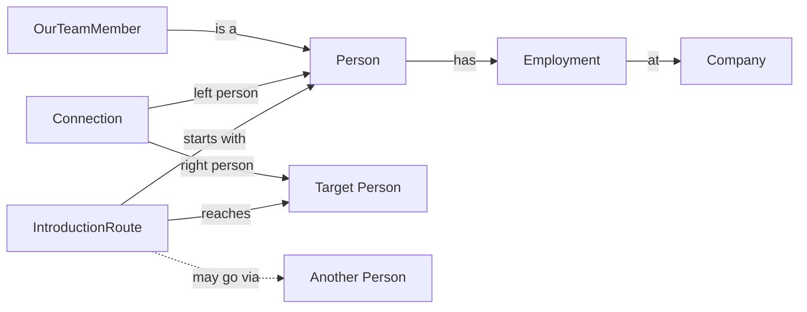

# Corporate introductions with RelationalAI

A Snowflake Cortex agent and local people-graph explorer for a synthetic corporate network. The agent resolves people and companies, authors a restricted read-only PyRel query, and executes relationship rules and native graph reasoning in RelationalAI. It returns introduction routes, normalized strengths, employment evidence and execution references.

## What it does

- Active scoring: **corporate-affinity-v5**. Employment overlap, workplace proximity, temporal decay, complete-career normalization and squared duration are calculated in RAI. Friendship is deferred. A fixed fourth-root transformation provides the displayed strength; raw scores remain available.
- Active agent: strongest eligible **one- or two-hop** routes, with natural-language reasons, bold recommended people and request/native transaction references.
- Local explorer: on-demand one-hop neighborhoods, edge decomposition, and native RAI community/betweenness snapshots for the declared leadership cohort. The display selects the strongest N connections; it does not show a representative sample of the entire neighborhood.
- **Three-hop work is experimental and not deployed.** Controlled fixtures passed, but full-team queries timed out on the existing engine. The code is preserved under `experiments/three_hop_agent/`.
- Connection settings and credentials stay local. The corporate deployment uses account-specific resource names; see the setup notes before pointing it at another account.

## How the people fit together

The model has six business concepts:

| Concept | What it means |
|---|---|
| **Person** | Anyone in the network, including our PE employees |
| **Company** | An employer, including our PE firm |
| **Employment** | A person's job at a company, with a title, dates and workplace details |
| **OurTeamMember** | A Person who belongs to our separate 100-person team roster |
| **Connection** | A calculated link between two people, with strength and employment evidence |
| **IntroductionRoute** | A possible path from a starting person to a target, directly or through another person |



An OurTeamMember is the same person everywhere: the same ID, career history and connections. Their previous jobs connect them to the companies where they worked. When you ask who on our team can reach someone, these team members are the starting people.

The business concepts are in `corporate_agent/ontology.py`. Employment has explicit `person` and `company` links, and both Person and Company expose their employment records. Job titles come from the original career tables. The rules in `scoring.py` turn qualifying employment overlaps into person-to-person connections; `model.py` finds the introduction routes. A Connection answers “why are these two people connected?” An IntroductionRoute answers “how could we reach this person?” Each route keeps its ordered person IDs, hop count, combined strength and reason. Direct routes have no intermediary; two-hop routes have one.

Shared periods and decay slices are calculation details. They let the edge inspector explain each score, but they aren't extra business entities you need to navigate. The scoring rules use shared time, location, recency, career length and squared duration. Friendship is deferred, and community or centrality measures don't add a score bonus.

## Project layout

| Path | Purpose |
|---|---|
| `corporate_agent/` | Business ontology, shared PyRel scoring, route rules, Cortex tools and validation |
| `pyrel_semantic_graph_explorer/` | FastAPI service and Next.js/Cytoscape visualization |
| `pe_deal_graph/corporate_graph.py` | Native RAI neighborhood and pair queries |
| `data/` | Synthetic generators, small regression fixtures and the separate 100-person PE team |
| `sql/corporate_agent_audit.sql` | Application and native execution audit queries |
| `artifacts/` | Selected existing validation evidence and legacy offline fixtures |
| `tests/`, `specs/` | Tests and requirements, including the incomplete three-hop amendment |
| `experiments/three_hop_agent/` | Undeployed three-hop implementation and bounded benchmark |

The original PE deal-graph demo, exports and small fixtures remain for regression coverage. See [the legacy README](LEGACY_README.md) and [historical cleanup notes](docs/housekeeping/README.md). Historical deployment commands are not instructions to recreate retired schemas.

## Local setup

Use Python 3.13, uv and Node.js 20.9 or newer. Create your own `raiconfig.yaml` from `raiconfig.example.yaml` and supply your own Snowflake PAT file outside the repository.

```bash
uv sync --python 3.13
uv pip install --python .venv/bin/python -r pyrel_semantic_graph_explorer/service/requirements-corporate.txt
cd pyrel_semantic_graph_explorer/ui-next
npm ci
cd ../..
bash pyrel_semantic_graph_explorer/start.sh
```

The UI runs at http://127.0.0.1:3000 and the API at http://127.0.0.1:8000. These steps expect the source tables and RAI engine for the configured account to exist. See [the handoff notes](docs/GITHUB_HANDOFF.md) before deploying to another account. Node/npm serve the visualization; RAI calculates relationships and neighborhoods.

## Data included and omitted

The corporate generator produces 1,000,000 fictional people across 1,000 companies, with 1–6 distinct employers per career and mean observed tenure near four years. The separate PE team has 100 employees and 450 employment records. Large corporate and enrichment CSVs are omitted from this copy; generators and compact validation manifests are included. Small baseline/10K fixtures and offline exports remain for local tests.

To regenerate the original corporate dataset locally:

```bash
.venv/bin/python data/generate.py --corporate --people 1000000 --companies 1000 --seed 42 --out data/corporate_1m_1000_companies
.venv/bin/python data/generate.py --corporate-check --out data/corporate_1m_1000_companies
```

The generators refuse existing destinations. `data/corporate_enrichment_v2/` intentionally contains only the manifest used by the explorer fingerprint. Read [the regeneration notes](docs/GITHUB_HANDOFF.md#data-regeneration) before generating enrichment.

## Validation and evidence

Validation records keep their original request and native transaction IDs:

- [V5 score and route acceptance](artifacts/corporate_affinity_v5_acceptance.json)
- [Natural response presentation acceptance](artifacts/corporate_presentation_acceptance.json)
- [Investigation of clustered displayed strengths](artifacts/normalized_score_cluster_investigation.json)
- [Original corporate dataset validation](docs/datasets/corporate_1m_1000_companies/VALIDATION.json)

The ontology regression checks compare the team roster, typed employment links, scores, routes and cohort metrics with locally saved v5 results. Generated ontology baselines and account-specific execution records stay local.

For the active formulas, source tables, scope and audit behavior, see [corporate agent documentation](corporate_agent/README.md). Independent SQL/Python oracles are validation tools; they do not supply production graph answers.
